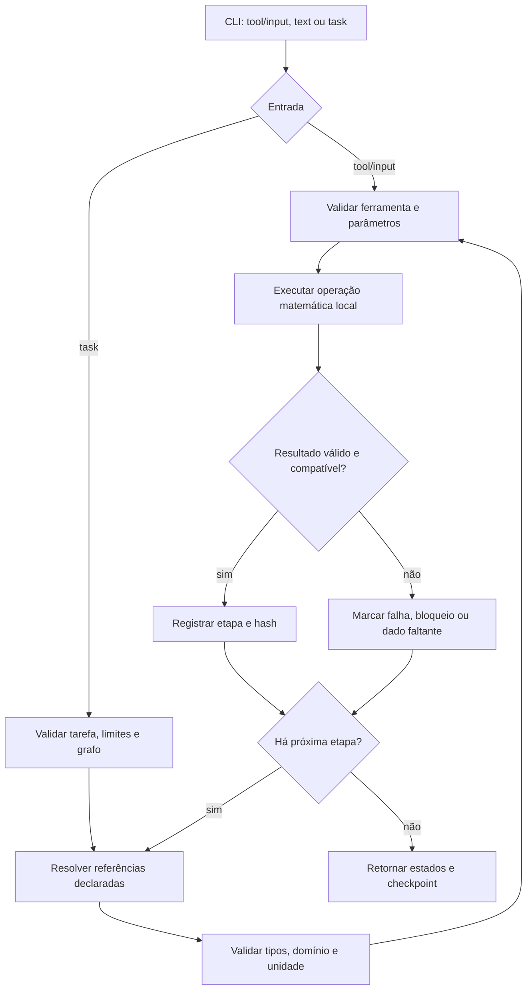

# Coordenação interna de tarefas matemáticas

## Missão e fronteiras

O CLI aceita `{"task": ...}` para organizar uma ou mais operações matemáticas já contratadas. Etapas são seriais, têm IDs únicos e dependem apenas de etapas anteriores. O coordenador seleciona a ferramenta declarada, acompanha cada etapa e consolida estados, resultados, dependências e checkpoint. Cada chamada recebe a entrada normal da ferramenta correspondente; o runtime valida a entrada resolvida e a saída antes de expor um resultado a outra etapa.

As entradas e saídas usam os schemas [`task.schema.json`](../contracts/v1/task.schema.json) e [`task-result.schema.json`](../contracts/v1/task-result.schema.json). As ferramentas disponíveis são `calculation.evaluate`, `calculation.symbolic`, `calculation.solveEquation`, `calculation.solveSystem`, `calculation.convertUnits` e `calculation.addQuantities`.

O coordenador não interpreta pedidos em linguagem natural, não chama modelo e não inventa variáveis, unidades ou precisão. O consumidor deve fornecer os parâmetros explícitos. As ferramentas selecionadas são determinísticas e sem efeitos colaterais. Não há novos servidores MCP, acesso a shell/rede, treinamento ou persistência local de entrada, resultado ou checkpoint.

Não são criados subagentes: as capacidades atuais são operações determinísticas locais, e separá-las em processos com contexto próprio não oferece benefício demonstrado. A alternativa aplicada é a composição serial por uma única função, com profundidade de delegação zero. Não foi feita comparação de qualidade, duração ou consumo de um grupo de subagentes, pois essa estratégia não existe nesta implementação; uma proposta futura requer caso e medição próprios.

## Tipos, domínio e unidades

Referências usam `{ "$resultFrom": "etapa", "field": "campo" }` e precisam de dependência declarada. Apenas resultados numéricos `exact` ou `approximate` podem alimentar outra operação:

- `calculation.evaluate.value` é reutilizável apenas quando a unidade de saída é vazia e os domínios de origem e destino são iguais.
- `calculation.convertUnits.convertedAmount` mantém `targetUnit`; o próximo estágio deve declarar a mesma unidade como `sourceUnit` ou na quantidade consumidora.
- `calculation.addQuantities.sum` mantém a unidade declarada; a próxima etapa deve usar exatamente a mesma unidade.
- Soluções simbólicas/polinomiais não são escalares numéricos e não podem ser injetadas como operandos.

Conversões entre unidades precisam de uma etapa explícita `calculation.convertUnits`. A ferramenta de destino valida novamente o contrato e a gramática do valor; incompatibilidade de dimensão ou domínio bloqueia a etapa antes de sua chamada.

## Limites, falhas e checkpoint

| Limite | Padrão | Teto/condição |
| --- | ---: | --- |
| Bytes de entrada JSON | — | 80.000 |
| Etapas | 8 | 8 |
| Tempo | 60 s | 60 s; observado entre e após chamadas síncronas |
| Tentativas por etapa | 1 | 2 apenas para erro recuperável explícito |
| Concorrência na tarefa | 1 | 1 |
| Profundidade de delegação | 0 | 0 |
| Saída JSON | 256.000 bytes | configurável entre 1.024 e 256.000 |

Entrada insuficiente e ambígua pede dados ao consumidor. Erros, incompatibilidades, cancelamento, timeout e etapas parciais têm estados explícitos. A tarefa não executa etapas posteriores quando uma dependência não termina com saída válida. Timeout/cancelamento são cooperativos e não interrompem à força uma chamada de SymPy já iniciada.

O checkpoint contém hash do objetivo, das etapas e dos resultados, sem armazenar dados em disco. Em uma retomada, as operações puras são recalculadas e seus hashes comparados; diferenças falham explicitamente em vez de usar resultado externo como autoridade. Todas as operações atuais são declaradas sem efeitos colaterais, então o replay não duplica escrita.

## Fluxo

## Avaliação e rastreabilidade

Os testes do runtime executam operações diretas e compostas pelo CLI em subprocesso. O caso de incompatibilidade entre domínios usa uma saída sintética para testar a barreira do coordenador; a etapa aparece como `simulated`, sem afirmar que o agente calcula números complexos. Os demais casos da esteira usam as ferramentas determinísticas existentes. Esta capacidade não chama modelo local nem integra outro agente.

As verificações de contrato cobrem a entrada e a saída de tarefa. Os testes de orquestração cobrem dependências, tipos, domínio, unidade, cancelamento, timeout, repetição, isolamento entre requisições e retomada por recálculo. A suíte MCP existente permanece separada e comprova o transporte das ferramentas de cálculo, não a coordenação por um servidor MCP.

- Requisitos: [REQUIREMENTS.md](REQUIREMENTS.md), especialmente N02, N06 e N07.
- Arquitetura: [ARCHITECTURE_PLAN.md](ARCHITECTURE_PLAN.md).
- Competências: [SPECIALIZATIONS.md](SPECIALIZATIONS.md).
- Contratos: [MCP v1](../contracts/v1/README.md).
